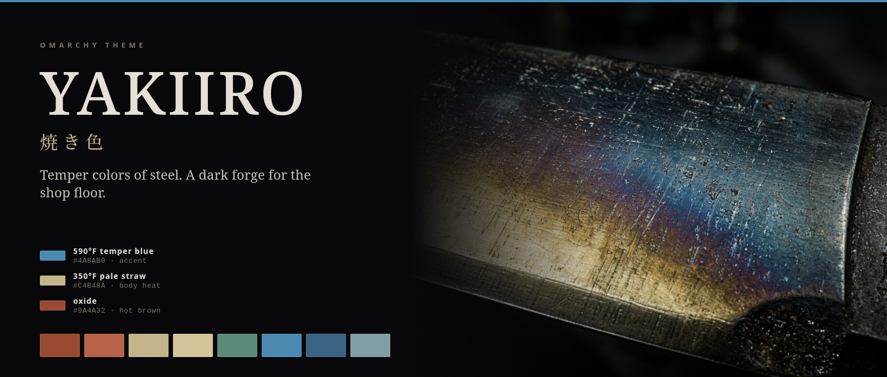
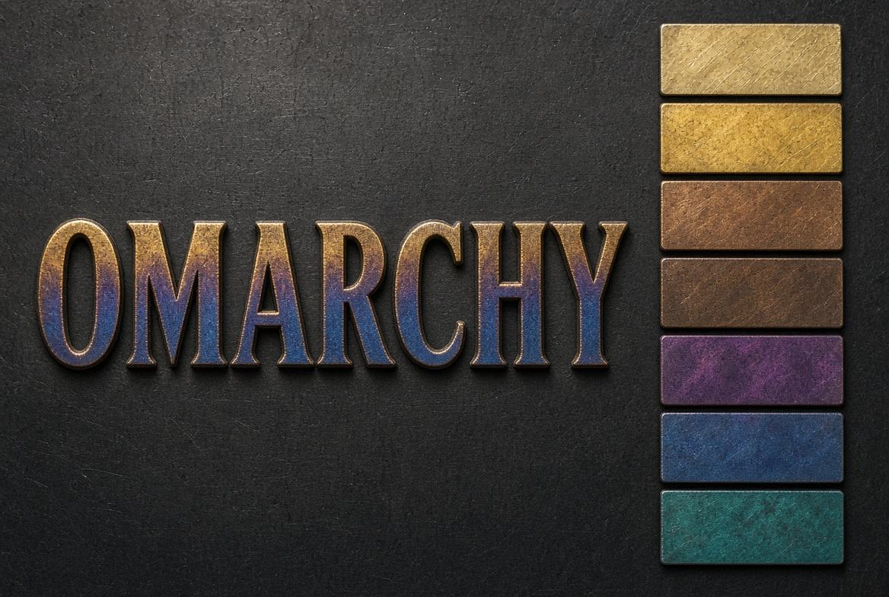
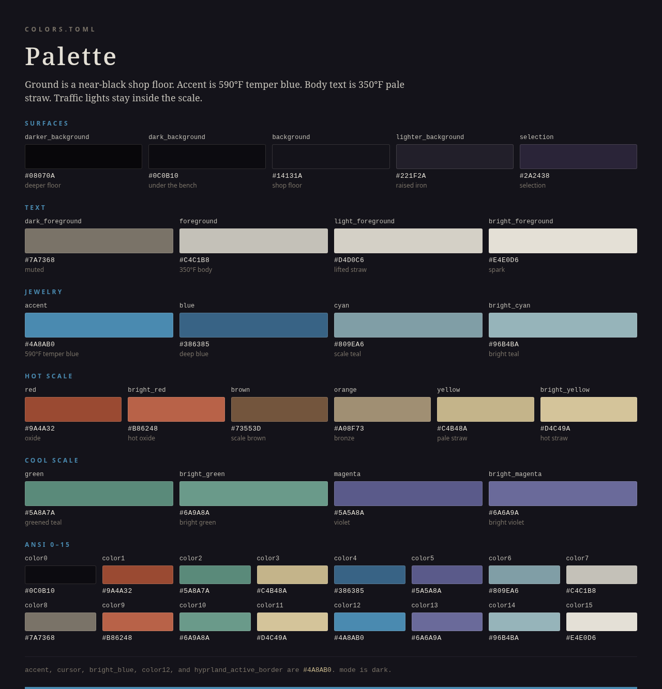
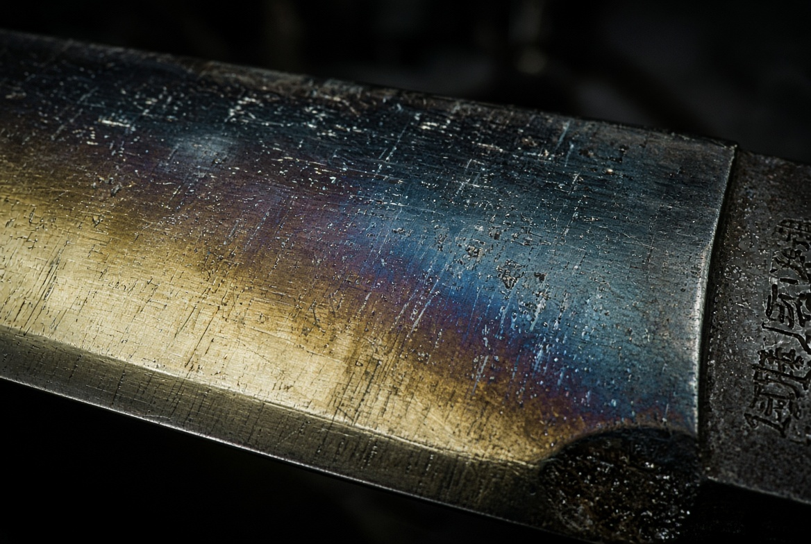
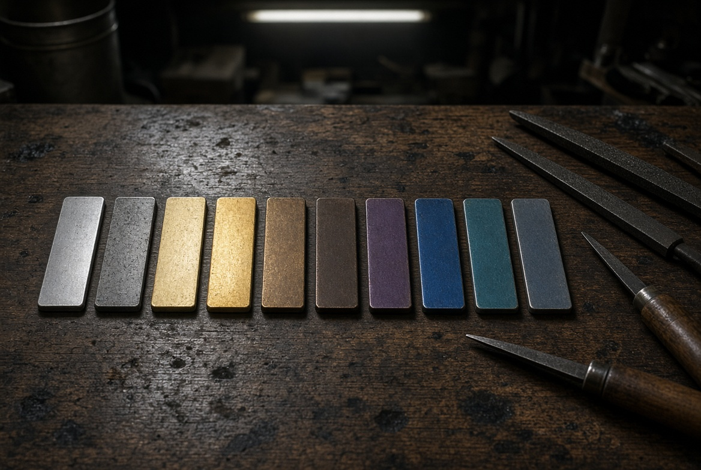
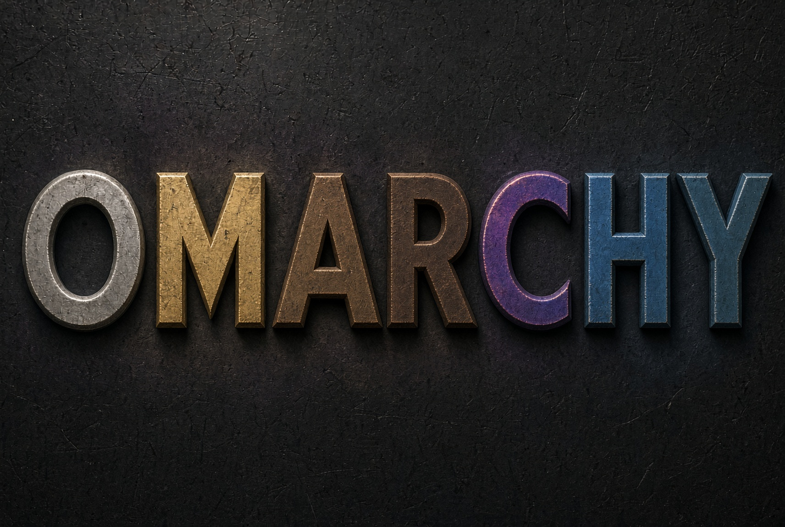
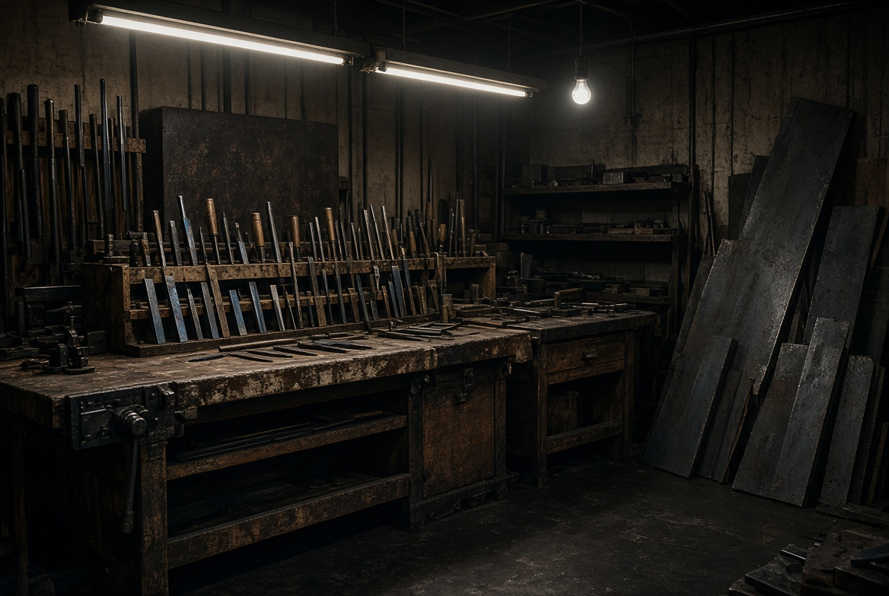
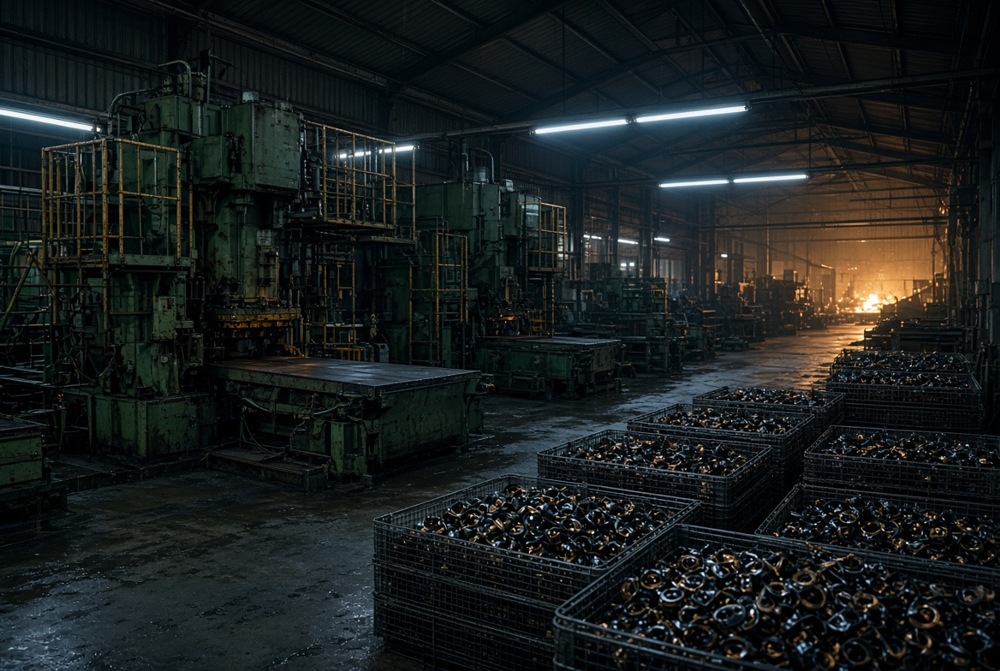
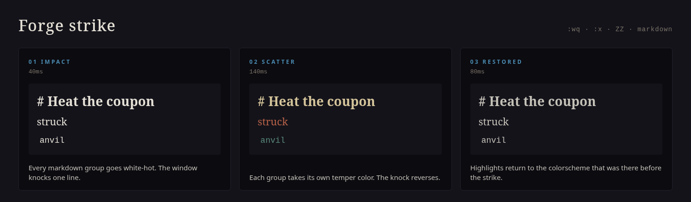

<p align="center">
  
</p>

<h1 align="center">焼き色 · Yakiiro</h1>

<p align="center">
  A dark Omarchy theme cut from the temper colors of steel.<br>
  Shop-floor charcoal, 590°F temper blue, 350°F pale straw.
</p>

Yakiiro is the color a blade takes in the fire. This repo is that palette for [Omarchy](https://omarchy.org): `colors.toml`, five wallpapers, the theme mark, an anvil strike, and a Neovim plugin that rings it when you write a markdown file.

## Install

The repository name is part of the install. Omarchy strips a leading `omarchy-` and a trailing `-theme`, so this repo lands on disk as `yakiiro`.

```bash
omarchy theme install https://github.com/toddvasquez/omarchy-yakiiro.git
```

That clones into `~/.config/omarchy/themes/yakiiro` and applies the theme. If that directory already exists, the installer replaces it.

```bash
omarchy theme current
omarchy theme bg next
```

`omarchy theme bg next` walks the wallpapers in filename order, `1` through `5`.

Omarchy rebuilds terminal, bar, lock, and editor colors from `colors.toml`. A theme installed from git does not get to run its own Lua. The forge below is a Neovim plugin you turn on yourself.

<p align="center">
  
</p>

## Palette

Ground is `#14131A`. The accent, the cursor, the focus border, and ANSI 12 are the same temper blue, `#4A8AB0`. Body text is pale straw, `#C4C1B8`. Reds, greens, and yellows stay inside the scale: oxide, greened teal, and straw, not traffic-light primaries.

<p align="center">
  
</p>

| | Hex | Where it sits |
| --- | --- | --- |
| Shop floor | `#14131A` | `background` |
| Deeper floor | `#08070A` | `darker_background` |
| Raised iron | `#221F2A` | `lighter_background` |
| Body text | `#C4C1B8` | `foreground` |
| Spark | `#E4E0D6` | `bright_foreground` |
| Muted | `#7A7368` | `muted` |
| 590°F temper blue | `#4A8AB0` | `accent` |
| Pale straw | `#C4B48A` | `yellow` |
| Oxide | `#9A4A32` | `red` |
| Greened teal | `#5A8A7A` | `green` |
| Focus border | `#4A8AB0` | `hyprland_active_border` |

`icons.theme` names `Yaru-prussiangreen`.

## Wallpapers

<p align="center">
  
  
  
</p>

<p align="center">
  
  
</p>

| File | Plate |
| --- | --- |
| `backgrounds/1-omarchy-stamped.jpg` | The word, stamped in the scale |
| `backgrounds/2-yakiiro-blade.jpg` | Blade face, straw into blue |
| `backgrounds/3-showa-workshop.jpg` | Bench, files, bar stock |
| `backgrounds/4-heisei-press.jpg` | Press hall and furnace |
| `backgrounds/5-coupon-bench.jpg` | Coupons on the bench |

## Neovim forge

On a markdown buffer, while the current Omarchy theme is yakiiro, `:wq`, `:x`, and `ZZ` write, strike, then quit. Any other buffer keeps the ordinary command.

The strike plays `sounds/anvil.ogg` through `pw-play`, `paplay`, or `mpv`, flashes the markdown highlights white-hot, scatters them through the temper scale, and puts the colorscheme back.

<p align="center">
  
</p>

Omarchy's Neovim colorscheme is aether, and aether keeps the palette. The forge does not repaint markdown while `vim.g.colors_name` is `aether`. The strike still runs. Resting heading, link, and code colors apply when some other colorscheme is active and the theme name is still yakiiro.

`:YakiiroStrike` plays the strike and leaves the buffer open.

After the theme is installed, load the plugin from the clone. On an Omarchy LazyVim config, save this as `~/.config/nvim/lua/plugins/yakiiro-forge.lua`:

```lua
return {
  dir = vim.fn.expand("~/.config/omarchy/themes/yakiiro/nvim"),
  name = "yakiiro-forge",
  lazy = false,
}
```

Skip that file if `yakiiro_forge` is already on your runtimepath.

The plugin looks for the anvil in this order: beside this repo (`sounds/anvil.ogg`), then `~/.config/omarchy/themes/yakiiro/sounds/anvil.ogg`, then the theme Omarchy has staged.

## Build

`colors.toml` is the source. `make` redraws the palette plate from it and checks the theme, the images, the sound, and a headless Neovim load of the forge.

```bash
bash scripts/render_graphics.sh
bash scripts/check.sh
```

`make` runs those two targets when Make is installed. Rendering needs Chromium and ImageMagick. The check needs Neovim.

## Layout

```text
colors.toml          palette Omarchy generates from
icons.theme          Yaru-prussiangreen
preview.png          theme-switcher mark
backgrounds/         five wallpapers
sounds/anvil.ogg     the strike
nvim/                Neovim plugin (lua/ and plugin/)
docs/                README plates
```

## License

[MIT](LICENSE). The palette, the plugin, the wallpapers, the mark, and the anvil ship together so the theme can be installed as a whole.
